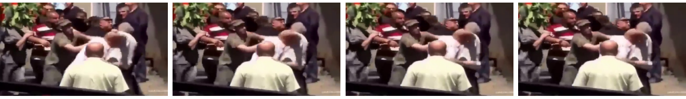
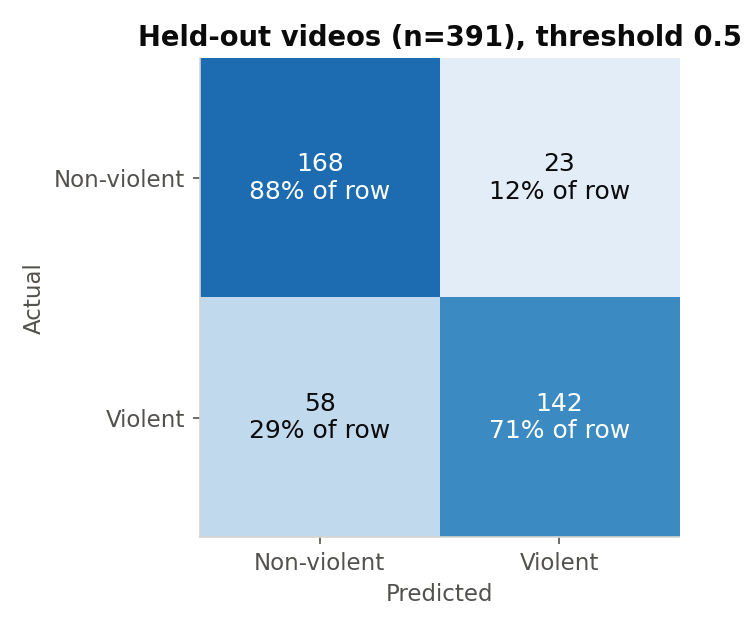
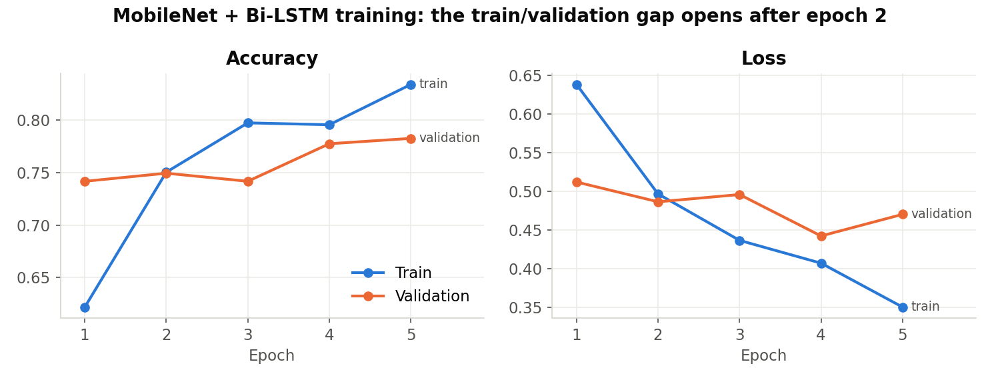
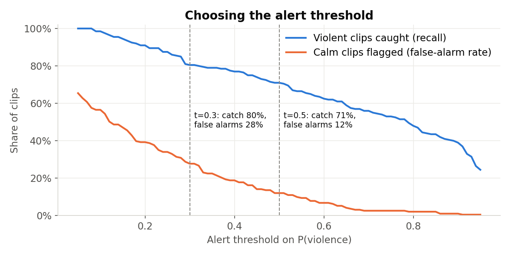

# Video Violence Detection + Crowd Analytics

A CCTV-style video analytics pipeline that combines two computer-vision models:

1. **Violence detection:** MobileNet looks at each frame and a Bi-LSTM reads the sequence, giving the probability that a
   clip shows violence. On held-out videos it scores **79.3% accuracy**.
2. **Crowd analytics:** YOLOv8 counts people in every frame and turns the count into a density level
   (**LOW / MEDIUM / HIGH**).

Both results are drawn onto the output video, so an operator sees *what* is happening and *how crowded* the scene is.

<p align="center"></p>

## How it works

```
video clip
   ├─► first 10 frames, 160×160 ─► MobileNet (ImageNet, frozen) per frame ─► Bi-LSTM(64) ─► P(violence)
   │
   └─► every frame ─► YOLOv8n "person" detections ─► people count
                                                   ─► density = people per 100k pixels
                                                      LOW < 5 ≤ MEDIUM < 15 ≤ HIGH
                         │
                         ▼
     annotated video: "Violence: VIOLENT" · "People Count: 7" · "Crowd Density: MEDIUM"
```

| Choice | Why |
|---|---|
| Frozen MobileNet as the frame encoder | Small and fast on a CPU. Pretrained features mean only the LSTM has to learn from 1,560 clips |
| Bi-LSTM over frames | Violence is motion: a single frame of a raised arm is ambiguous, a sequence is not |
| YOLOv8n (nano) for people | The smallest YOLO model, fast enough to run on every frame |

## Data

[Real Life Violence Situations](https://www.kaggle.com/datasets/mohamedmustafa/real-life-violence-situations-dataset):
**1,951 clips** (951 non-violent, 1,000 violent), split 80/20 stratified into **1,560 training / 391 held-out**.

## Results

### Violence classifier (391 held-out videos)

| Metric | Value |
|---|---|
| Accuracy | **79.3%** |
| Violent clips caught (recall) | 71.0% |
| Precision when it says "violent" | 86.1% |
| Calm clips wrongly flagged | 12.0% |

<p align="center">
  
  
</p>

These numbers come from the notebook's saved predictions, restricted to the 391 held-out videos. The split is
rebuilt exactly with `train_test_split(..., random_state=42, stratify=y)`.

**Reading the training curves:** validation accuracy levels off near 78% while training accuracy keeps climbing to
83%, and validation loss rises again in epoch 5. The model has started to memorise. More data or augmentation will
help more than more epochs.

### The alert threshold is a business decision

The model's default cut-off (0.5) misses **29% of violent clips**. For a security team, a missed fight usually costs
more than a false alarm, so the cut-off should be chosen on purpose:

<p align="center"></p>

| Threshold | Violent clips caught | Calm clips flagged |
|---|---|---|
| 0.5 (default) | 71% | 12% |
| 0.4 | 77% | 18% |
| 0.3 | 80% | 28% |

## Business impact

**Use case: a control room watching many CCTV cameras** (a stadium, a transit hub, a mall). People can only watch a
few screens at a time, so most footage is never seen live. The model's job is to put the right clip in front of the
operator.

An illustrative estimate, using assumptions you can swap for real figures:

| Assumption | Value |
|---|---|
| Cameras | 200 |
| Clips per camera per hour (10-second segments) | 360 → **72,000 clips/hour** |
| Share of clips that are violent | 0.1% → 72 / hour |
| Operator review time per flagged clip | 10 seconds |

At **threshold 0.3**, the model flags 80% of the 72 violent clips (58) plus 28% of the 71,928 calm ones (≈ 19,900). That is
still **56 operator-hours of review per hour**, which is unusable. The arithmetic shows something the accuracy figure
hides: **with rare events, the false-alarm rate dominates the cost**. The deployment plan follows from it:

1. **Gate on crowd context first.** Only score cameras where YOLO sees ≥ 2 people. Most CCTV frames show empty
   corridors, so this removes most calm clips before the violence model runs.
2. **Require persistence.** Alert only when *consecutive* clips cross the threshold. A real fight lasts longer than
   10 seconds; a single misfire doesn't.
3. **Measure the false-alarm rate on the client's own footage** before agreeing an SLA, because public-dataset clips
   are far more balanced than real CCTV.

The **crowd-density** output has value without the violence model. HIGH-density alerts give stewards early warning
of crush risk at gates and platforms. People-count time series also support staffing and capacity planning.

## Limitations

- **The held-out set was also the validation set.** Early stopping and checkpointing watched it, so 79.3% is slightly
  optimistic. The next version should have a separate train / validation / test split.
- **10 consecutive frames is only ~0.3 seconds of video** (see the near-identical sample frames above). Sampling 10 frames
  spread across the whole clip would let the LSTM see real motion. It is the cheapest likely improvement.
- Only 5 epochs, with MobileNet frozen. Fine-tuning the top MobileNet blocks is untested.
- Crowd density is *people per pixel area*, so the LOW/MEDIUM/HIGH thresholds depend on camera height and angle. They
  would need calibrating per camera.
- The crowd and fusion steps ran on the first 100 and 50 clips per class to save time. They are demos, not evaluated.

## Reproduce

1. Download the dataset (link above) and unzip it so that `Real Life Violence Dataset/NonViolence` and `/Violence`
   sit in the repo root, or change `DATA_DIR` in the first code cell.
2. Run:

```bash
pip install -r requirements.txt
jupyter notebook violence_crowd_analytics.ipynb
python scripts/make_charts.py      # redraws docs/*.png from docs/results.json
```

Loading all 1,951 clips at 10×160×160×3 takes about 1.5 GB of RAM.

## Team

Somaya Ossama · **Jana Emad**

## License

MIT
